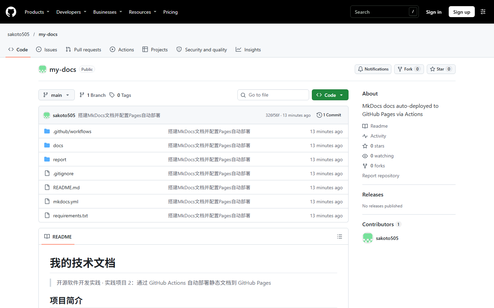
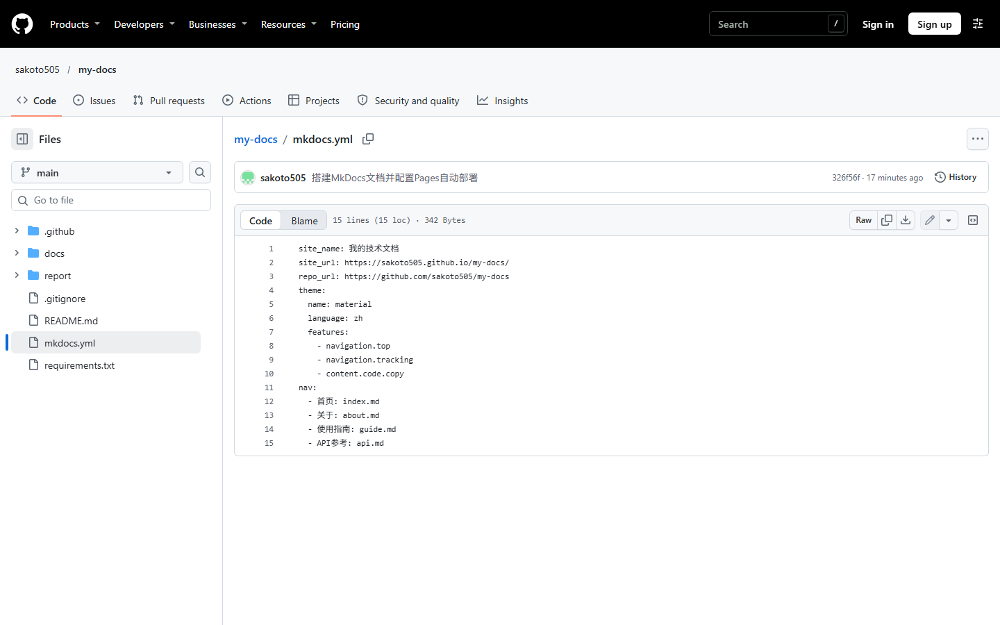
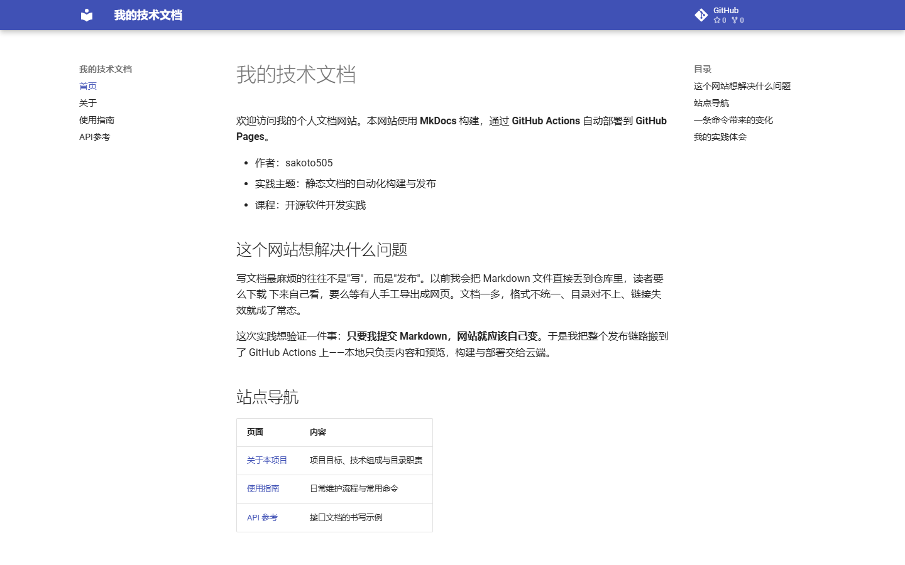
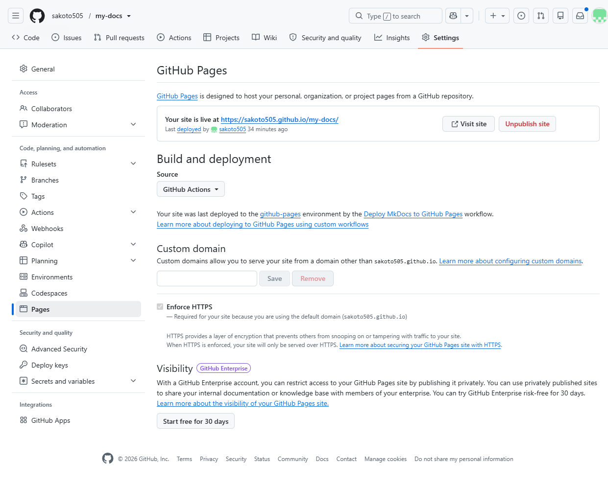
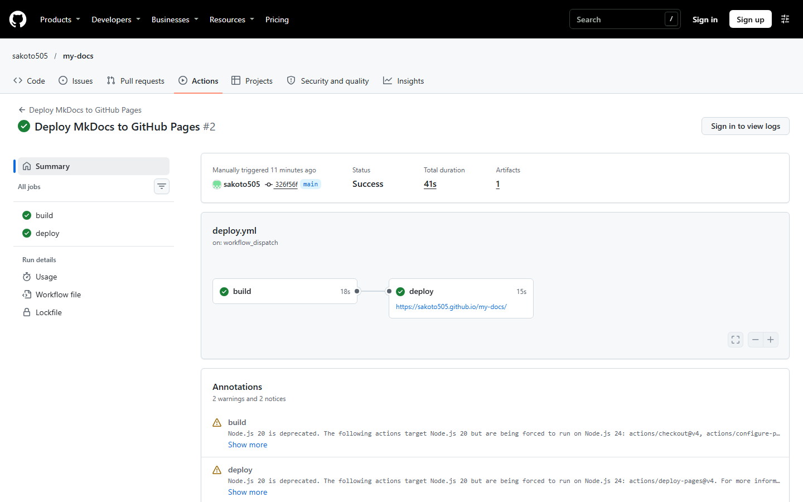
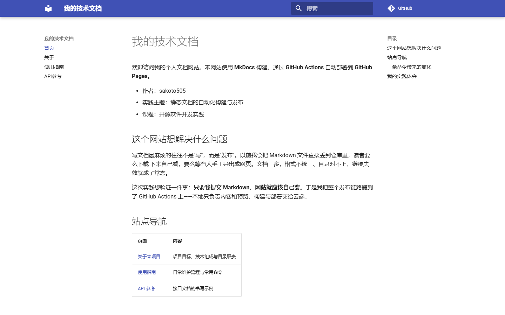

# 实践项目 2：个人实验报告

## 1. 基本信息

- GitHub 登录名：**sakoto505**
- 个人仓库地址：<https://github.com/sakoto505/my-docs>
- 最终网站地址：<https://sakoto505.github.io/my-docs/>

## 2. 实践过程与关键截图

### 2.1 仓库创建

登录 GitHub 后通过右上角 `+` → `New repository` 创建仓库，Owner 选择本人账号，仓库名 `my-docs`，
可见性选择 **Public**，并勾选初始化 README。创建完成后确认默认分支为 `main`，与工作流中的
`branches: [main]` 保持一致。

选择 Public 的原因：GitHub Pages 对公开仓库的静态站点托管免费开放，而本次作业本身也要求仓库公开
可核验。



> 截图①：仓库首页，可看到所有者 `sakoto505`、仓库名 `my-docs` 与 `Public` 标识。

### 2.2 项目结构与 MkDocs 配置

仓库结构如下：

```text
my-docs/
├── .github/workflows/deploy.yml
├── docs/{index,about,guide,api}.md
├── report/{README.md,images/}
├── mkdocs.yml
├── requirements.txt
├── .gitignore
└── README.md
```

`mkdocs.yml` 关键配置：

```yaml
site_name: 我的技术文档
site_url: https://sakoto505.github.io/my-docs/
theme:
  name: material
  language: zh
nav:
  - 首页: index.md
  - 关于: about.md
  - 使用指南: guide.md
  - API参考: api.md
```

三个概念的作用：

| 名称 | 作用 |
| --- | --- |
| `docs/` | 文档源文件目录，MkDocs 的输入，也是我唯一需要手写内容的地方 |
| `nav` | 站点导航，路径**相对于 `docs/`**；漏写页面时 `--strict` 会报警告 |
| `site/` | 构建产物目录，由 `mkdocs build` 生成，已写入 `.gitignore`，不进主干 |



> 截图②：项目目录与 `mkdocs.yml`。

### 2.3 本地构建与预览

创建虚拟环境并安装依赖后执行严格构建：

```bash
python -m venv .venv
.\.venv\Scripts\Activate.ps1
python -m pip install -r requirements.txt
python -m mkdocs build --strict
python -m mkdocs serve
```

本地检查了以下内容：

- 四个页面是否都能通过顶部导航互相跳转；
- 首页到「关于 / 使用指南 / API 参考」的三个站内链接是否可点击；
- 表格（技术组成、参数表、错误码表）在页面中的渲染是否正常；
- 代码块的语言高亮与复制按钮是否生效；
- `--strict` 构建是否零警告（有警告即视为失败）。



> 截图③：本地 `mkdocs build --strict` 成功记录 / 本地预览页面。

### 2.4 Pages 设置

在个人仓库依次进入 `Settings` → `Pages` → `Build and deployment` → `Source`，选择
**GitHub Actions**。

这里特意**没有**选择「Deploy from a branch」。两种方式的区别是：分支发布需要把构建产物提交到
`gh-pages` 之类的分支，由 GitHub 从分支取静态文件；而 GitHub Actions 发布是由工作流上传制品，
再由官方 `deploy-pages` 动作发布，源码仓库里不会出现构建产物。



> 截图④：Pages 发布来源选择 GitHub Actions。

### 2.5 Actions 首次构建和部署

推送触发工作流后，`build` 与 `deploy` 两个任务依次执行：前者检出源码、配置 Python、安装依赖、
执行 `mkdocs build --strict` 并上传 `site/` 制品；后者在 `needs: build` 之后运行，把制品发布到
`github-pages` 环境。



> 截图⑤：首次运行记录，`build` 与 `deploy` 均为成功（绿色）。

### 2.6 网站访问与四页导航检查

访问 <https://sakoto505.github.io/my-docs/>，四个页面均已打开检查：导航栏可从任意一页跳到其余三页，
首页的站内链接、关于页的表格、使用指南的命令块、API 页的 JSON 示例均显示正常。



> 截图⑥：公开网站首页，保留地址栏。

### 2.7 第二次推送与自动更新验证

在 `docs/index.md` 末尾加入一句可辨认的文字：

```markdown
> 自动部署验证：这是我第二次推送后更新的内容。
```

提交并推送后**没有**手动点 Deploy，而是观察到本次 `push` 自动触发了新的工作流运行，成功后刷新
网站即出现该句文字。

- 对应提交：<https://github.com/sakoto505/my-docs/commits/main>
- 对应 Actions 运行：<https://github.com/sakoto505/my-docs/actions>


> 截图⑦：第二次 push 触发的成功运行 + 网站出现新增文字（可拆为两张）。

## 3. 问题与解决

| 现象 | 关键信息 | 原因 | 解决 |
| --- | --- | --- | --- |
| 构建报 `Doc file 'xxx.md' contains a link ... is not found` | `--strict` 把警告升级为错误 | 站内链接写成了相对路径但文件名大小写或后缀不对 | 统一改为不带 `docs/` 前缀的相对路径，如 `(about.md)`，重新构建通过 |
| 工作流没有在推送后启动 | Actions 页面无新运行 | 只修改了 `report/README.md`，而 `paths` 只监听 `docs/**`、`mkdocs.yml`、`requirements.txt`、工作流自身 | 属预期行为；改 `docs/` 下文件即可触发 |
| 首次访问网站样式不完整 | 页面能开但 CSS 404 | `site_url` 与仓库名不匹配，导致资源路径错误 | 将 `site_url` 修正为 `https://sakoto505.github.io/my-docs/` |
| PowerShell 无法激活 venv | `Activate.ps1` 被策略阻止 | 执行策略限制 | 改用 Git Bash 执行 `source .venv/Scripts/activate`，不改系统策略 |

除上述外，我核对了以下配置与日志：`Settings → Pages` 的 Source 是否为 GitHub Actions、
工作流 YAML 缩进是否为空格、`deploy` 任务是否具备 `pages: write` 与 `id-token: write` 权限、
以及运行日志中「Upload site artifact」与「Deploy to GitHub Pages」两步的输出。

## 4. 原理理解

**1. `docs/` 和 `site/` 各保存什么？为什么不用手工修改 `site/`？**

`docs/` 保存 Markdown 源文件，是人和工具共同维护的输入；`site/` 保存 `mkdocs build` 渲染出的
HTML、CSS、JS 等静态产物，是给浏览器看的输出。`site/` 每次构建都会从 `docs/` 重新生成，手工修改
会在下次构建时被覆盖，因此正确做法是改源码而不碰产物。

**2. 本次工作流在什么情况下自动运行？**

在 `main` 分支上推送、且改动命中了 `paths` 列表中的文件（`docs/**`、`mkdocs.yml`、
`requirements.txt`、`.github/workflows/deploy.yml`）时自动运行；另外可通过
`workflow_dispatch` 在 Actions 页面手动触发。

**3. `build` 与 `deploy` 两个任务有什么区别？**

`build` 在普通权限下完成"取源码 → 装依赖 → 构建 → 上传 site 制品"，只读内容；`deploy` 通过
`needs: build` 依赖前者，运行在 `github-pages` 环境中，并单独申请 `pages: write` 与
`id-token: write` 权限，负责把制品发布成可访问的网站。拆成两个任务既符合最小权限原则，也让
失败定位更清晰。

**4. 只修改 `report/README.md` 会触发部署吗？为什么？**

不会。工作流的 `paths` 过滤器只监听文档源码、站点配置、依赖清单和工作流文件自身，报告目录不在
监听范围内，因此这次提交不会产生新的运行——这正是我第 2.7 节改用 `docs/index.md` 做更新验证的
原因。

**5. 本次方案为何无需创建 `gh-pages` 分支？**

因为采用的是 GitHub 官方的 Pages Actions：构建产物以 artifact 形式上传，再由 `deploy-pages`
直接发布到 Pages 服务，产物不落在 Git 历史里。`gh-pages` 分支只在使用「分支发布」模式时才需要，
那是另一种实现方式，本方案刻意避免混用。

## 5. 小结

这次实践把「写文档」和「发布文档」彻底拆开了：我只需保证 `docs/` 内容的正确性，构建、上传、
发布都由工作流完成。相比手工 `mkdocs gh-deploy`，自动化方案的优势不只是省事，而是**可重复**——
同样的源码一定得到同样的站点，出问题时也能顺着 Actions 日志一步步定位。
